  
  
  
  
  
  

  <b>🌐 An authoritative directory of enterprise iPaaS solutions, cloud sync pipelines, and open-source data movement connectors. ⚡</b>

---

## 📑 Table of Contents

- [📊 Market Overview](#-market-overview)
- [🏢 SaaS & Hosted Platforms](#-saas--hosted-platforms)
- [🔓 Open-Source Solutions](#-open-source-solutions)
- [⚖️ Comparison: SaaS vs Open-Source](#️-comparison-saas-vs-open-source)
- [📈 Star History](#-star-history)
- [💖 Support & Sponsorship](#-support--sponsorship)
- [🤝 Contributing](#-contributing)

---

## 📊 Market Overview

The global Integration Platform as a Service (iPaaS) market is estimated at **$15.6B in 2025 and projected to surpass $19.1B by 2026** (CAGR ~30%). The sector is **moderately fragmented**: while hyperscalers and legacy enterprise suites (Microsoft, Salesforce MuleSoft, AWS, Boomi) anchor significant enterprise market share, intense competition from modern challenger platforms and open-source ecosystems prevents total winner-take-all concentration.

---

## 🏢 SaaS & Hosted Platforms

The following hosted and managed enterprise integration platforms are sorted descending by company scale (market capitalization or private valuation):

| 🏷️ Platform / Connector | 🏛️ Provider / Valuation | 💳 Starting Tier Price | 🎁 Free Tier / Trial Limits | 🔌 Key Cloud & App Connectors |
| :--- | :--- | :--- | :--- | :--- |
| **[Azure Data Factory](https://azure.microsoft.com/products/data-factory/)** | Microsoft (~$3.1T Market Cap) | **$1.00** per 1,000 orchestration runs + **$0.25** / DIU-hour for data movement | Azure Free Account gives **$200 credit** (30-day limit) + free monthly quota of **1,000 activity runs** and **5,000 read/write operations** | Salesforce, AWS S3, Google Cloud Storage, SAP, Dynamics 365, Snowflake |
| **[Google Cloud Data Fusion](https://cloud.google.com/data-fusion)** | Alphabet / Google (~$2.1T Market Cap) | **$1.80** per instance-hour (Basic instance for pipeline design) + Dataproc compute execution charges | Google Cloud Free Tier provides **120 instance-hours free per month** per billing account (Basic instance) | Salesforce Plugin, BigQuery, AWS S3, Kafka, SAP, Cloud SQL |
| **[Amazon Web Services Connector for Salesforce](https://aws.amazon.com/connect/salesforce/)** | Amazon / AWS (~$2.0T Market Cap) | **Free** managed package on AppExchange (underlying Amazon Connect charges start at **$0.018/min**) | **12 months AWS Free Tier**: includes **90 minutes/month** of Amazon Connect usage, 1 DID number, and 30 minutes/month direct inbound calls | Bi-directional Salesforce CTI, AWS S3, Amazon Bedrock AI, Lambda |
| **[AWS AppFlow](https://aws.amazon.com/appflow/)** | Amazon / AWS (~$2.0T Market Cap) | **$0.001** per successful flow run + **$0.02** per GB data transferred | AWS Free Tier allows **10,000 flow runs/month** for the first 12 months (standard AWS Free Tier accounts) | Salesforce, Zendesk, ServiceNow, Slack, Amazon S3, Amazon Redshift |
| **[MuleSoft Anypoint Platform](https://www.mulesoft.com/)** | Salesforce (~$280B Market Cap) | **$2,000 / month** ($24,000/year base entry for Integration Starter / Anypoint Composer) | **30-day free trial** with full access to Anypoint Platform (API Designer, Studio, and Runtime Manager) | AWS Connector, Salesforce, SAP, NetSuite, Kafka, Microsoft Azure |
| **[Workato AWS & Salesforce Connector](https://www.workato.com/)** | Workato (~$5.7B Valuation) | **$75 / month** (Pro self-serve credit plan) or **$25,000 / year** (Enterprise Workspace base) | **14-day free trial** with access to Community recipes and standard connector testing | AWS Lambda, Amazon S3, Salesforce, Workday, ServiceNow, Snowflake |
| **[Fivetran Salesforce Connector](https://www.fivetran.com/)** | Fivetran (~$5.6B Valuation) | **$5.00** / month minimum per connection (Starter Plan on credit-ladder usage) | **Free Forever Plan** with limit of **500,000 Monthly Active Rows (MAR)**, 3,500 reverse ETL MAR, and 5,000 model runs/month | Salesforce, AWS Redshift, Snowflake, BigQuery, Databricks, PostgreSQL |
| **[Boomi Salesforce & Cloud Connector](https://boomi.com/)** | Boomi / TPG (~$4.0B Valuation) | **$99 / month** base platform fee + **$0.05** per message (Pay-As-You-Go tier) | **30-day free trial** with access to Boomi AtomSphere platform and pre-built integration templates | Salesforce, AWS S3, SAP, NetSuite, Microsoft Azure, Oracle |
| **[Celigo Salesforce-AWS Integrator](https://www.celigo.com/)** | Celigo (~$1.0B Valuation) | **$1,200 / month** ($14,400/year billed annually for Standard Edition) | **Free Edition** permanently limited to **2 endpoints and 1 active integration flow**; 30-day unrestricted trial available | Salesforce, AWS S3, Amazon Redshift, NetSuite, Shopify, QuickBooks |

---

## 🔓 Open-Source Solutions

Self-hostable, open-source integration engines, ELT platforms, and workflow orchestrators with community-backed cloud and CRM connectors. Sorted descending by GitHub Stars_Count:

| 📦 Project | 🌟 Github_Stars | 🎯 Focus & Capabilities | 🔌 Key Connectors |
| :--- | :--- | :--- | :--- |
| **[n8n](https://github.com/n8n-io/n8n)** |  | Fair-code workflow automation and AI-agent orchestration platform combining visual node-based design with custom JavaScript/Python code. | AWS (S3, SES, Lambda, SQS), Salesforce, Google Cloud, Postgres, Slack, 400+ nodes |
| **[Apache Airflow](https://github.com/apache/airflow)** |  | Industry-standard DAG-based workflow automation and orchestration framework written in Python. | `apache-airflow-providers-salesforce`, `apache-airflow-providers-amazon`, `google`, `microsoft-azure` |
| **[Activepieces](https://github.com/activepieces/activepieces)** |  | Open-source no-code business automation tool with native AI-agent steps and MCP (Model Context Protocol) support. | Salesforce, AWS S3, Google Workspace, OpenAI, HubSpot, Webhooks |
| **[Prefect](https://github.com/prefecthq/prefect)** |  | Modern Python workflow orchestration engine featuring dynamic task graphs, native async execution, and observability. | `prefect-aws` (S3, ECS, Lambda), `prefect-salesforce`, `prefect-gcp`, `prefect-snowflake` |
| **[Airbyte](https://github.com/airbytehq/airbyte)** |  | Leading open-source data movement engine for ELT pipelines and AI applications, synchronizing data across databases and warehouses. | Salesforce Source, AWS S3 / Redshift Destination, Azure Blob, BigQuery, Snowflake, 350+ connectors |
| **[Windmill](https://github.com/windmill-labs/windmill)** |  | Ultra-fast developer platform (Rust backend) turning scripts (Python, TypeScript, Go, Bash, SQL) into workflows and internal UIs. | AWS SDK integration, Salesforce REST API, Postgres, Snowflake, Webhooks |
| **[Dagster](https://github.com/dagster-io/dagster)** |  | Data-aware orchestrator focused on software-defined assets (SDAs), declarative data lineage, and data quality testing. | `dagster-aws` (S3, EMR, Athena), `dagster-salesforce`, `dagster-gcp`, `dagster-snowflake` |
| **[CloudQuery](https://github.com/cloudquery/cloudquery)** |  | High-performance open-source ELT framework specifically engineered for cloud infrastructure, security configurations, and asset inventories. | AWS, Azure, GCP, Salesforce, Kubernetes, PostgreSQL, BigQuery, Snowflake |
| **[Apache Camel](https://github.com/apache/camel)** |  | Versatile open-source enterprise integration framework based on Enterprise Integration Patterns (EIP) with 350+ connectors in Java, XML, or YAML. | `camel-salesforce`, `camel-aws2-s3`, `camel-azure-storage-blob`, `camel-google-pubsub`, Kafka |
| **[Apache NiFi](https://github.com/apache/nifi)** |  | Enterprise data logistics and stream processing platform providing interactive visual web-based drag-and-drop data routing and transformation. | PutSalesforce / GetSalesforce processors, PutS3Object / FetchS3Object, Azure Event Hubs, GCP PubSub |
| **[Meltano](https://github.com/meltano/meltano)** |  | Declarative code-first CLI and data integration engine powered by Singer taps and targets with native dbt integration. | `tap-salesforce`, `target-s3-csv`, `target-redshift`, `target-snowflake`, `target-bigquery` |
| **[Apache Hop](https://github.com/apache/hop)** |  | Hop Orchestration Platform: visual data integration and metadata-driven ETL/ELT platform designed to run on Spark, Flink, or local runtimes. | Salesforce Input/Output transforms, AWS S3 VFS, Azure VFS, Google Cloud Storage, JDBC engines |
| **[Singer Specification](https://github.com/singer-io/getting-started)** |  | Open-source standard for writing modular, composable UNIX-style data extraction scripts (taps) and data loading scripts (targets). | `tap-salesforce`, `target-s3`, `target-redshift`, `target-postgres` |

---

## ⚖️ Comparison: SaaS vs Open-Source

| 🔍 Dimension | 🏢 Hosted SaaS / iPaaS | 🔓 Open-Source Alternatives |
| :--- | :--- | :--- |
| **🛠️ Maintenance** | Fully managed, auto-scaled, SLA-backed infrastructure | Requires self-hosting (Docker, Kubernetes, VM) & ops monitoring |
| **🛡️ Security & Compliance** | Turnkey SOC2, HIPAA, ISO27001, FedRAMP certifications | Full data residency & air-gapped deployment control within your VPC |
| **💰 Pricing Model** | Predictable subscription fees or consumption-based (MAR, DIU, API calls) | Free software license; compute, storage, and maintenance overhead only |
| **⚙️ Extensibility** | Vendor app marketplace & low-code connectors | Source code access, custom connector SDKs, git-native CI/CD |

---

## 📈 Star History

---

## 💖 Support & Sponsorship

Thank you so much for exploring and using **Awesome Cloud Integration Connector**! 🚀

If you found this curated list helpful for evaluating iPaaS platforms, integrating cloud providers, or setting up open-source ETL pipelines:

- ⭐ **Star this repository** on GitHub to help others discover it.
- 🍴 **Fork the repo** and contribute your favorite connectors, recipes, and benchmarks.
- 📢 **Share with fellow data engineers & architects** on social media and dev communities.
- ☕ **Buy me a coffee / Sponsor**: If you'd like to support ongoing updates and maintenance, consider sponsoring via the [GitHub Sponsors Dashboard](https://github.com/sponsors/ishandutta2007).

Your support is deeply appreciated! ✨

---

## 🤝 Contributing

Contributions are welcome! Please read the guidelines below before submitting a pull request:
1. 💡 Verify that open-source projects have an active GitHub repository and public license.
2. 🏷️ For SaaS additions, provide concrete starting tier pricing, free tier/trial boundaries, and company valuation data.
3. 📝 Keep entries formatted with clear markdown tables and alphabetical or metric-based sorting.
